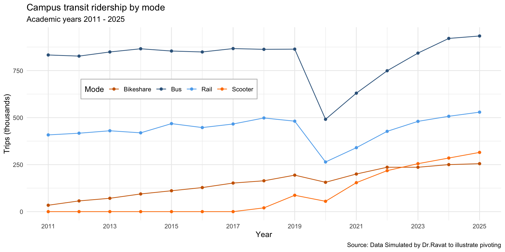
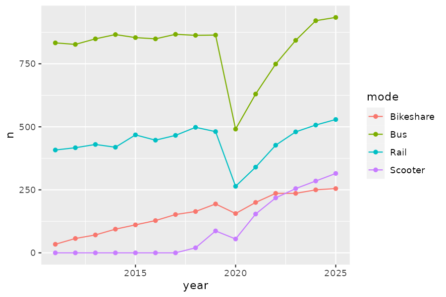

## Recreate this plot

{fig-align="center" fig-alt="Line plot of campus transit ridership in thousands of trips, 2011 to 2025, for four modes: Bus, Rail, Bikeshare, and Scooter. Bus and Rail ridership fall sharply in 2020 and then recover. Scooter ridership begins in 2018 and overtakes Bikeshare by 2023."}

## Data

The data are **simulated** to resemble ridership counts from SBMTD. Each row is a travel mode and each column from 2011 to 2025 holds the number of trips (in thousands) taken in that academic year. Let's load the data in.

```{r}
#| label: load-packages-data
#| message: false

library(tidyverse)

#load the data
transit <- read_csv("data/campus_transit.csv")
```

And let's take a look at the data.

```{r}
# Your code here 
```

Notice that the data are in a *wide* format: the year is spread across the column names, so there is no single `year` column that we could map to the x-axis.

## Pivoting

-  **Your Turn:** Pivot the `transit` data frame *longer* such that:

    -   Each row represents a mode / year combination
    -   `year` and `n`umber of trips (in thousands) for that year are columns in the data frame
    -   The resulting `year` column is numeric

```{r}
#| label: pivot

# Your code here 

```

-   **Your Turn:** Now, repeat your code from above, but this time **save the result** to a **new** variable name.

```{r}
#| label: pivot-with-transform-name
# Your code here 

```

## Plotting

-   **Your turn:** Now we will start making our plot. Create the following plot, which will serve as the "first draft" on the way to our final plot. Do this by adding on to your pipeline from earlier.

{fig-alt="Line plot of campus transit ridership over the years (2011 - 2025). Modes represented are Bus, Rail, Bikeshare, and Scooter. Bus and Rail dip sharply in 2020; Bikeshare and Scooter increase over time." fig-align="center"}

```{r}
#| label: plot-draft
# Your code here 
```

Hint: Use geom_point and geom_line

-   **Question**: Why was the pivot necessary in order to create this plot?

*Add your response here!*


-   **Question:** What aspects of the plot need to be updated to go from the draft you created above to the final plot at the beginning of this worksheet.

*Add your response here.*


- **Your turn:** Update x-axis scale such that the years displayed go from 2011 to 2025 in increments of 2 years. Do this by adding on to your pipeline from earlier the following code and make sure you understand this
`scale_x_continuous(breaks = seq(2011, 2025, 2))`

```{r}
#| label: plot-improve-1

```

-   **Your turn:** Update line colors using the following level / color assignments. Once again, do this by adding on to your pipeline from earlier.
    -   "Bus" = "steelblue4"

    -   "Rail" = "steelblue2"

    -   "Bikeshare" = "darkorange3"

    -   "Scooter" = "darkorange1"
    
     `scale_color_manual(
    values = c(
      "Bus" = "steelblue4",
      "Rail" = "steelblue2",
      "Bikeshare" = "darkorange3",
      "Scooter" = "darkorange1"
    )`

```{r}
#| label: plot-improve-2

```

-   **Your turn:** Update the plot labels (`title`, `subtitle`, `x`, `y`, and `caption`) and use `theme_minimal()`. Once again, do this by adding on to your pipeline from earlier.

```{r}
#| label: plot-improve-3

```

-   **Your Turn:** Move the legend into the plot, lay it out horizontally, make its background white, and its border gray.

```{r eval=FALSE}
#| label: plot-improve-4
transit_longer |>
  ggplot(aes(x = year, y = n, color = mode)) +
  geom_point() +
  geom_line() +
  scale_x_continuous(breaks = seq(2011, 2025, 2)) +
  scale_color_manual(
    values = c(
      "Bus" = "steelblue4",
      "Rail" = "steelblue2",
      "Bikeshare" = "darkorange3",
      "Scooter" = "darkorange1"
    )
  ) +
  labs(
    x = "Year",
    y = "Trips (thousands)",
    color = "Mode",
    title = "Campus transit ridership by mode",
    subtitle = "Academic years 2011 - 2025",
    caption = "Source: Data Simulated by Dr.Ravat to illustrate pivoting"
  ) +
  theme_minimal() +
  theme(
    legend.position = "inside",
    legend.position.inside = c(0.3, 0.68),
    legend.direction = "horizontal",
    legend.background = element_rect(fill = "white", color = "grey")
  )
```

-   Finally, set `fig-width: 10` and `fig-height: 5` for your plot in the chunk options.

```{r eval=FALSE}
#| label: plot-improve-5
#| fig-width: 10
#| fig-height: 5

transit_longer |>
  ggplot(aes(x = year, y = n, color = mode)) +
  geom_point() +
  geom_line() +
  scale_x_continuous(breaks = seq(2011, 2025, 2)) +
  scale_color_manual(
    values = c(
      "Bus" = "steelblue4",
      "Rail" = "steelblue2",
      "Bikeshare" = "darkorange3",
      "Scooter" = "darkorange1"
    )
  ) +
  labs(
    x = "Year",
    y = "Trips (thousands)",
    color = "Mode",
    title = "Campus transit ridership by mode",
    subtitle = "Academic years 2011 - 2025",
    caption = "Source: Data Simulated by Dr.Ravat to illustrate pivoting"
  ) +
  theme_minimal() +
  theme(
    legend.position = "inside",
    legend.position.inside = c(0.3, 0.68),
    legend.direction = "horizontal",
    legend.background = element_rect(fill = "white", color = "grey")
  )
```

-   **Question:** Looking at your finished plot, what two stories does it tell about campus transit from 2011 to 2025?

*Add your response here.*


## Let's now pivot wider!

-   **Your turn:** Just like you can pivot longer, you can pivot wider. Let's convert our longer data frame back into the wider one in a single pipeline and save it as transit_wider.

```{r}
#| label: wider

```

-   **Your turn:** Pivot `transit_longer` wider in a *different* way and save it as transit_by_year: make one row per year and one column per mode. Which of the two wide layouts would be more convenient for computing the total number of trips across all modes in each year? Try it.

```{r}
#| label: wider-modes


```


-   **Your turn:**  Compute the total number of trips across all modes in each year in two ways - using `transit_longer`  and using `transit_by_year` above. 


```{r solution, eval=FALSE}
transit_by_year |>
  mutate(total = Bus + Rail + Bikeshare + Scooter)

transit_longer |> group_by(year) |> summarize(total = sum(n))
```
  
